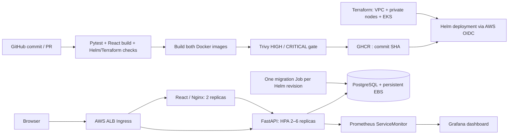

# QueueDesk

A support ticket tracker built for the DevOps capstone. Create a ticket, assign someone to it, set its priority, and move it from **open → in progress → resolved**. The queue can be searched by subject and filtered by status or priority.

The app is intentionally small. The main part of this project is getting it from a Git commit to a tested container image, a Kubernetes deployment, and a monitored service.

The stack is React, FastAPI and PostgreSQL. Docker Compose runs it locally; Terraform and Helm define the AWS deployment. The requirements come from the [Session 21 brief](https://github.com/Nency-Ravaliya/devops-heros/blob/main/session21-python/README.md) and [grading rubric](https://github.com/Nency-Ravaliya/devops-heros/blob/main/session21-python/GRADING.md).



## Run locally

Install Docker and Docker Compose, then run:

```bash
docker compose up --build -d --wait
```

Open **http://localhost:3000** and create a few tickets using the form. The API docs are at **http://localhost:8000/docs**. Compose starts PostgreSQL, runs the database migration, and then starts the backend and frontend.

The default database password is for local use. To change it, copy `.env.example` to `.env` before the first run. Use a URL-safe password because Compose includes it in the connection string.

Stop the stack with `docker compose down`. Ticket data stays in the database volume; `docker compose down -v` deletes it.

If a port is already in use, set `BACKEND_PORT` or `FRONTEND_PORT` in `.env`. For native Vite development against a different API port, set `API_PROXY_TARGET=http://127.0.0.1:<port>`.

## API

| Method | Path | Purpose |
|---|---|---|
| GET | `/api/tickets` | List, search and filter; `status`, `priority`, `q`, `limit`, `offset` |
| GET | `/api/tickets/stats` | Global totals, including unresolved urgent tickets |
| GET | `/api/tickets/{id}` | Read a ticket |
| POST | `/api/tickets` | Create a ticket (201) |
| PUT | `/api/tickets/{id}` | Replace editable fields |
| DELETE | `/api/tickets/{id}` | Delete a ticket (204) |
| GET | `/health` | Cheap process liveness check |
| GET | `/ready` | Database and migrated table availability; 503 on failure |
| GET | `/metrics` | Request counters and latency histograms |

```bash
curl -X POST http://localhost:8000/api/tickets \
  -H 'Content-Type: application/json' \
  -d '{"title":"Cannot access workspace","requester":"alex@example.com","priority":"high"}'
```

## Develop and test

Python 3.12+ and Node.js 22.12+ are required. Use PostgreSQL for the running application. Tests default to isolated in-memory SQLite databases; CI additionally tests against disposable PostgreSQL.

```bash
python3.12 -m venv .venv
source .venv/bin/activate
pip install -r backend/requirements-dev.txt
cd backend
pytest -v
ruff check .
ruff format --check .
```

From `backend/`, export your PostgreSQL `DATABASE_URL`, run `alembic upgrade head`, and start `uvicorn app.main:app --reload --port 8000`. From `frontend/`, run `npm ci` and `npm run dev`; Vite proxies `/api` to port 8000. Dependency versions are committed in `requirements*.txt` and `package-lock.json`. Regenerate Python locks with `uv pip compile --no-header --no-annotate backend/requirements.in -o backend/requirements.txt`, followed by the dev input.

Tests cover CRUD, invalid inputs, missing records, filtering, pagination, statistics, readiness failures, metric labels, and migration upgrade/downgrade. For PostgreSQL tests, set `TEST_DATABASE_URL` to a **disposable database whose name starts with `test_`**. The fixtures drop their tables after every test.

For frontend changes, `npm run format` formats the source and `npm run build` checks the production build. The frontend has a small API helper, a ticket form, a ticket table, and the main queue page under `frontend/src/`.

## A few design choices

- **A separate migration job:** both backend replicas share one database. Alembic runs once per release, rather than once in every API container.
- **Two health endpoints:** `/health` checks that the API is running. `/ready` also checks the database table, so a Pod won't receive traffic before the schema is ready.
- **Commit SHA image tags:** the deployed image can be traced to the exact source revision. Both images must pass Trivy before either is published.
- **PostgreSQL in the cluster:** this keeps the classroom deployment in one Helm release. It has persistent storage, but it is a single instance with no automatic backup or failover.
- **One NAT gateway:** private worker nodes need outbound access to pull images. One gateway keeps the demo smaller, but leaves an availability-zone failure point.

## Delivery and infrastructure

- [Deployment guide](docs/deployment.md): Terraform, AWS access, EKS bootstrap, Helm, GHCR and GitHub Actions variables.
- [Monitoring guide](docs/monitoring.md): scraping, Grafana panels, load generation and HPA.
- [Troubleshooting runbook](docs/troubleshooting.md): real deployment failures and isolated failure labs.
- [Submission checklist](docs/submission.md): module mapping, evidence to capture and demo order.
- [Verification record](evidence/validation.txt): checks actually performed in this workspace and remaining external checks.

The workflow runs on pull requests and pushes to `main`. Main-branch builds publish to GHCR. Deployment starts after `DEPLOY_ENABLED` is set and the AWS `production` environment is configured. Terraform provisioning is a separate step; see the deployment guide for the order and required variables.

## Repository map

```text
backend/                 FastAPI, SQLAlchemy, Alembic, Pytest
frontend/                React, CSS, Vite, multi-stage Nginx image
.github/workflows/       Test → build → scan → publish → deploy
terraform/               AWS networking, EKS, worker nodes, IAM/OIDC, EBS CSI
helm/queuedesk/          App chart, migration Job, Ingress, HPA, ServiceMonitor
k8s/                     Namespace and EBS StorageClass
monitoring/              Prometheus/Grafana values and dashboard
troubleshooting/         Isolated broken-image and broken-Service labs
docs/                    Deployment, operations, submission
evidence/                Actual verification and evidence collection instructions
```

## Current status

The 18 backend tests pass with SQLite and PostgreSQL. The frontend production build, Helm lint/rendering and local HTTP smoke check also pass. The reported Docker Compose run built both images, completed the migration, and started healthy PostgreSQL, backend and frontend containers. GitHub Actions now passes tests, frontend build, Helm checks and Terraform validation. The backend image was changed to Python Alpine after the original Debian image failed Trivy; the replacement image passes the local HIGH/CRITICAL gate. AWS deployment and the live monitoring setup have not been verified; the checklist lists the remaining evidence.

Authentication, HTTPS and database backups are outside this demo's current scope. Use sample data. Helm rollback restores the application release but does not undo database migrations.

The linked course repository did not include `student-guide.md` when checked. Confirm the final submission instructions with the instructor.
